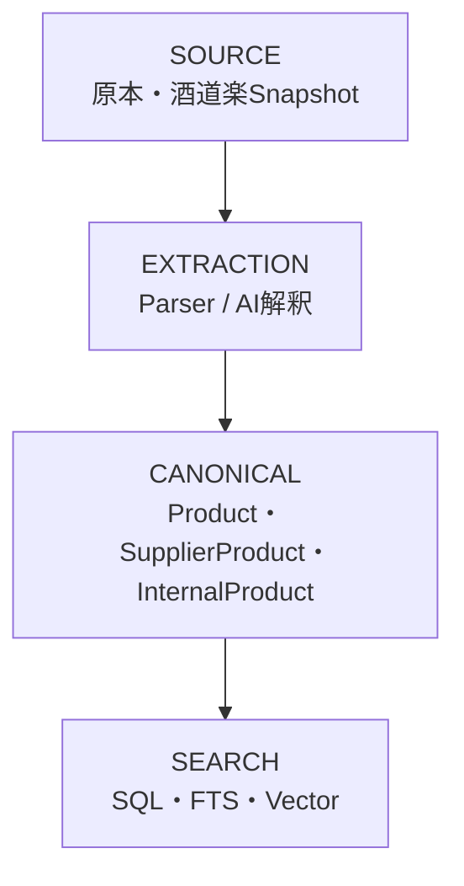
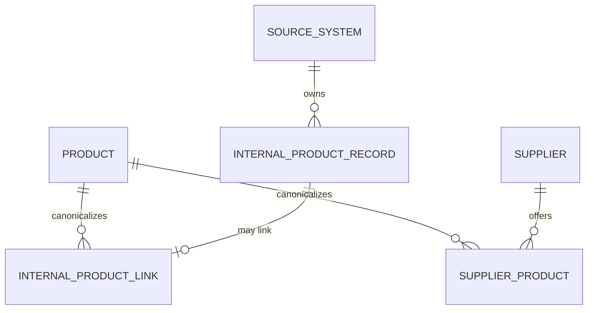

# Architecture

## データ境界

SOURCEとCANONICALは永続資産、EXTRACTIONとSEARCHはVersion付きで再生成可能とする。

## Identity model

- `Product`: 検索・商品知識の単位。現実世界の商品。
- `SupplierProduct`: 仕入先の商品コード、原表記、仕入条件の単位。
- `InternalProductRecord`: 酒道楽など社内基幹の商品レコード。同期元のIdentityと表記を保持。
- `InternalProductLink`: 酒道楽商品とProductの対応。未対応や要確認を許容。

同じCanonical Productに複数のSupplierProductと複数の酒道楽商品が紐づいてよい。酒道楽側で仕入先別に別商品となる現在運用を壊さない。

## 酒道楽連携

1. Adapterが酒道楽DB/API/Exportを参照専用で読む。
2. SyncRunと取得Hashを記録する。
3. `InternalProductRecord`へupsertするが過去Snapshotも保持する。
4. 正規化文字列、名称、JAN、容量、分類、備考等から検索文書を生成する。
5. MatchingはCanonical Product候補を出し、確信度不足はReviewへ送る。

酒道楽がPostgreSQLであっても、本システムから直接joinしない。可用性、Schema変更、誤更新、将来の置換から境界を守るためである。

## Search

`SearchPlan`は次を分離する。

- Structured filters: category, country, region, vintage, volume, price, inventory, supplier, source system, 酒道楽登録有無
- Full text: 商品名、生産者、別名、原表記、酒道楽商品名・カナ・備考
- Semantic: 味わい、用途、料理相性、曖昧な表現

検索結果の既定単位はProduct。ただし`view=internal`では酒道楽商品を1行単位で返す。未Linkの酒道楽商品も検索結果から落とさない。

## AI boundaries

- `IDocumentUnderstandingProvider`
- `IStructuredExtractionProvider`
- `ISearchInterpretationProvider`
- `IEmbeddingProvider`
- `IProductMatchingProvider`

OrchestratorがAI呼出しの要否を決める。Parserで確定できた値にAIを使わない。
