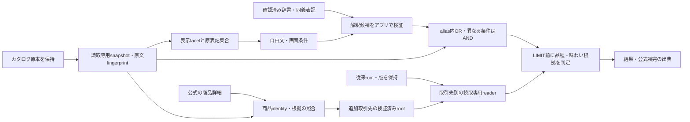

# 検索条件・公式根拠の改善候補（2026-11-24）

本書は隔離環境で統合した候補の説明です。本番適用、実本番の商品根拠の採用、全商品の補完完了を示しません。基点は master `db533dbacd2555635d4abe44c8c33244479c04af`、公式補完側の固定段階は `406a67ca699fff5e991d8c1180def01a41f18be2` です。

## 選択肢と検索条件

国・産地・容量・ヴィンテージは、表示上の選択肢と、その選択が対象にする原表記の集合を分離しました。商品・SourceEvidenceの原文を書き換えません。

- 国は確認済み辞書とNFKC・空白・大文字小文字の同値だけを使います。「フランス／France／ﾌﾗﾝｽ」を一つに表示し、検索は対応する原表記すべてに一致させます。
- 産地は国ごとに扱います。別国の同名地を一つの商品条件に混ぜません。国未指定の検索は表記同値のexact名に限定し、別国の辞書aliasへ広げません。
- 右岸の確認済み12群は、各群内の同義表記を共有JSONから参照します。Saint-EmilionとGrand Cru等の別群は維持します。地理的な親子・所属集合は同義語へ変換しません。
- 容量は正の数値mlを重複なく表示し、既存の未設定値0だけを選択肢から除外します。商品の値は保持します。
- ヴィンテージは単独4桁と「2023年」等の表記差、NFKC・空白差を統合します。既存NV/MVの扱いを保持し、NVの年注記、複数年、熟成年数、意味不明な値を推測で同じ年やNVへ変えません。

UI用の `facets` を追加し、モデル用の国・産地等の元表記optionsは保持します。ヴィンテージは従来の契約どおり正規化値を使います。国・産地の選択後も価格・在庫・容量・年等の他条件を残します。新DTOの必須項目・型が不正なら検索前に止め、指定をAllへ緩和しません。旧serverのmissing/nullは従来表示へ戻します。未使用の追加キーだけを停止理由にはしません。

未知の国・産地の意味的な同一性を推論して統合する機能ではありません。すべての未知表記を解消したとは扱いません。

## 甘辛度と商品根拠

本人の確定に従い、検索条件と根拠判定の両方で「半甘口」を既存canonical「やや甘口」へ正規化します。原資料の語を保持し、「甘口」とは別条件です。「甘い香り」は甘口の根拠にしません。中甘口・半辛口・外国語の追加対応や残糖閾値は、この決定から推測しません。

品種・甘辛度・風味の語は `wine-search.ja.json`、国と共有する産地同義群は `catalog-facets.ja.json` がデータ定義です。味わいの肯定文法・否定・対象範囲・競合判定はC#の規則です。広い自由文をすべて理解するものではなく、認識できない文は厳密な根拠へ採用しません。複雑な肯定文の再現率は未測定です。

## 公式情報の再利用

豊通のFE4113/FE4218は、専用の商品領域adapterでSKU・銘柄・生産者・年号・容量・色とURLを照合します。生産者紹介や関連商品から根拠を拾いません。原本の実文字列fingerprintと検証済み保存・期限も照合し、価格・在庫を補完値で上書きしません。別品種100%同士等の矛盾は不採用です。

従来root/ExtractorVersionを保持し、追加取引先だけを別root/版へ明示的にrouteします。新routeの欠損を別の版へのfallback理由にせず、有効な競合記録も欠損だけで解消扱いにしません。既存レコードの版や期限を書き換えません。

今回の公式adapterは品種の補完です。公式の甘辛度・酸・ボディ・香り属性の補完は、別の出典付き属性仕様として残ります。19社の入口登録は、19社の商品補完完了を意味しません。

意味検索・新モデル・新索引は追加していません。根拠のない商品の復活や、価格・在庫条件の緩和は行いません。

## 検証と利用方法

元の14商品・12問は変更せず、追加した甘辛度・公式補完・facetケースと分けます。合成DBのSQL、実サービス、実画面、保存HTMLの再生、実本番の検証を別に記録します。原本digestと出典の結合も確認します。

公式側の独立合成試験では補完OFF 0件→ON 2件、従来方式1件の維持を確認しました。ObservedChecksの先行2拒否は失敗時binの固定が不足し原因未確定です。後の固定binによるcold4試行成功は、過去失敗の解消証明とは分けて保持しています。

固定サンプルCLIと各層の到達範囲は [公式補完PoCの手順](OFFICIAL-EVIDENCE-POC.md) を参照してください。任意の自由文を受け付けるWebではありません。P14sの既存.NET 10 SDK・復元済み依存物で実行し、合成cacheだけを新しい一時領域へ保存します。

実本番のsupplier code・保存後原文fingerprint・新規公式取得・cache採用、最新の本番sourceとの統合、独立した本番DB比較とWeb/llm-linkのペア受入は未完です。カタログ担当の切替結果・明示引渡しを確認してから具体化し、過去の期待版や単回手順をそのまま再使用しません。
